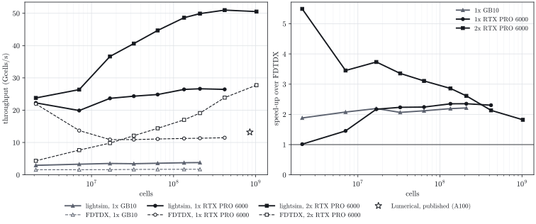

# lightsim

**Rust-native simulation engine for photonic chips.** Its core is a GPU-first FDTD
solver; around it are waveguide mode solvers, eigenmode expansion, finite-element
heat, electrostatics and modes, circuit simulation and inverse design. The GPU
kernels are written in Rust and compiled to PTX with NVIDIA's [cuda-oxide](https://github.com/NVIDIA/cuda-rust);
one PTX build runs on Ampere through Blackwell (tested on RTX PRO 6000, sm_120,
and GB10, sm_121). It scales from one GPU to several GPUs (peer-to-peer halos)
and several machines (TCP halos). A Python package imports **gdsfactory**
layouts, solves waveguide modes on the exact Yee grid and computes S-parameters
and adjoint gradients.

Documentation and worked examples: **[developer.su3labs.com/lightsim](https://developer.su3labs.com/lightsim/)**.



*Vacuum box with absorbing boundaries, single precision; solid lines lightsim,
dashed lines FDTDX on the same GPUs; the star is a published Lumerical GPU
figure (different GPU, not our measurement). Full tables: [docs/benchmarks.md](https://github.com/su3co/lightsim/blob/main/docs/benchmarks.md).*

On one RTX PRO 6000 lightsim runs at 22–27 Gcells/s: 1.19× faster than FDTDX on a
2 M-cell box and 2.2–2.4× faster from 17 M cells up. On two GPUs it reaches
52 Gcells/s, 1.8–5.4× faster than FDTDX. On FDTDX's own directional-coupler
benchmark it is 3.5–5.8× faster, on feature scenes (dispersive media, Bloch
boundaries, rotated crystals) 2.4–18×. A 3-D inverse-design gradient takes
3.0–5.5× less time than with FDTDX on the same GPU and about 65× less than
with Meep's adjoint solver on 64 CPU cores; in 2-D a direct frequency-domain
solver on a CPU is faster at small sizes and level with one GPU at large ones.

## Features

- **Dimensions:** 3-D; 2-D with TE, TM or both polarizations and any invariant axis (three field components per polarization, its own CPU loops and GPU kernel); 2.5-D effective index. [Which to use when](https://github.com/su3co/lightsim/blob/main/docs/guide/dimensions.md).
- **Grid and materials:** non-uniform rectilinear mesh, anisotropic sub-pixel smoothing (also at the surfaces of fitted, dispersive dielectrics), dielectric / conductive / magnetic / PEC media, Lorentz–Drude–Debye poles (per axis or oriented), full ε and σ tensors, χ² and χ³ nonlinearity with a Raman response, magneto-optic (gyrotropic) poles, director fields for liquid crystals, four-level gain media (rate-equation and two-electron models), complex Hermitian tensors, zero-thickness sheets (graphene), user-defined material plug-ins, imported index grids, a Sellmeier material library with passive pole fitting, conducting sheets and graphene as one-cell layers.
- **More than FDTD:** waveguide mode solvers (finite differences and finite
  elements: bends, PML, anisotropy, group index), eigenmode expansion,
  heat and electrostatics by finite elements (thermo-optic phase shifters,
  capacitance, Pockels modulators) and circuit simulation from netlists,
  all without external programs.
- **Drop-in for gdsfactory's plugins:** `lightsim.gplugins` has the
  interface of the Meep plugin (same arguments, units and cache files), so a
  script switches solver by changing one import.
- **Sources:** dipoles, plane waves (oblique, s- and p-polarised; a whole spectrum at one fixed angle from a single broadband run, or from a sweep), focused Gaussian beams, eigenmodes, TFSF (also in dispersive backgrounds).
- **Boundaries:** CPML, adiabatic absorbers (passive, for dispersive media and metals that a PML amplifies), periodic, Bloch (k ≠ 0), PEC, PMC, automatic mirror-symmetry reduction.
- **Monitors and analysis:** DFT fields, flux planes and boxes, mode expansion (S-parameters), far field, diffraction orders, harmonic inversion / Q, time series, energy.
- **Design flow:** gdsfactory import, or a GDSII file from any layout tool with a technology file and a port list; port-driven S-parameter sweeps (3-D or 2.5-D effective index) written as Touchstone, `.npz` or SAX models; composite S-matrix problems for devices too large for one simulation; random-probe gradients whose cost does not grow with the number of ports; complex-ε mode solver, adjoint gradients and exact gradients through reverse mode, density and shape optimisation, exact time reversal.
- **Execution:** CPU reference engine (single precision, or double with the `f64` build), fused single-kernel GPU step, multi-GPU slabs, multi-node TCP ranks; Python API, CLI and Rust API.
- **Interface:** a browser view of the set-up, of a run in progress and of the results (`lightsim.gui`; `sim.view()`).

How lightsim compares with Lumerical FDTD and FDTDX, feature by feature, and what Lumerical has that lightsim does not: [docs/features.md](https://github.com/su3co/lightsim/blob/main/docs/features.md).

## Install

The first release, 0.1.0, is not on PyPI yet; until it is, build from source
(see the installation guide). Once published:

```bash
pip install lightsim
```

Wheels for Python 3.10 and later: Linux x86_64 and aarch64 with GPU support
built in (it needs only an NVIDIA driver ≥ 580 at run time, and runs on the
CPU without one), macOS arm64 and x86_64 for the CPU. Details:
[installation guide](https://developer.su3labs.com/lightsim/docs/guide/install/).

## Build from source

Requirements: Rust 1.99.1; for GPUs, CUDA 13 and a driver ≥ 580. The PTX is
committed, so the cuda-oxide toolchain is only needed when editing
`kernels/src/main.rs` (`scripts/build_kernels.sh`).

```bash
git clone https://github.com/su3co/lightsim && cd lightsim
cargo build --release -p lightsim-cli --features cuda      # CLI (drop --features for CPU only)
pip install maturin && maturin develop --release --features cuda   # Python package
```

The repository layout and the checks to run before a pull request are in
[CONTRIBUTING.md](https://github.com/su3co/lightsim/blob/main/CONTRIBUTING.md).

## Quick start

```python
import gdsfactory as gf, numpy as np
from lightsim.sparams import write_sparameters
gf.gpdk.PDK.activate()

sp = write_sparameters(gf.components.mmi1x2(), wavelengths=np.linspace(1.5e-6, 1.6e-6, 21), device="cuda:0")
print(abs(sp["o2@0,o1@0"]) ** 2)    # ~0.49 at 1.55 um
```

The call runs one simulation of 14.6 million cells per port: 42 s for the
full S-matrix on one RTX PRO 6000. `port_symmetry="auto"` uses the mirror
symmetry of the splitter and takes 28 s for the same matrix;
`input_ports=["o1"]` computes only the column printed here in 14 s.

Lower-level simulations are built with `lightsim.Simulation`, `Medium`, `Box`,
sources and monitors and run with `sim.run(device="cpu" | "cuda:0" | "cuda:0,1")`
(see `examples/` and `python/tests/`).

```bash
lightsim validate --device cuda:0                          # physics validation suite
lightsim run sim.json --device cuda:0,1 --out results.json
HOSTS=node0,node1,node2 scripts/multi_node.sh sim.json    # one rank per machine
```

## Validation

70 physics cases with analytic references, from Fresnel and Mie scattering to
Bloch, nonlinear, tensor and dispersive-source checks, eight of them in 2-D.
All of them pass on CPU, on one and two RTX PRO 6000s and on the GB10, with
fused and split kernels.
Every test of FDTDX's simulation suite that checks physics or a gradient has a counterpart, the double-precision ones in a double-precision CPU build. Details:
[docs/validation.md](https://github.com/su3co/lightsim/blob/main/docs/validation.md) and [docs/test_parity.md](https://github.com/su3co/lightsim/blob/main/docs/test_parity.md).

## License

MIT; see [LICENSE](https://github.com/su3co/lightsim/blob/main/LICENSE).
