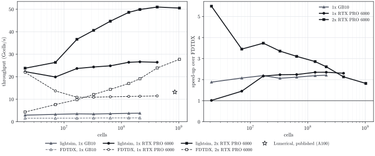
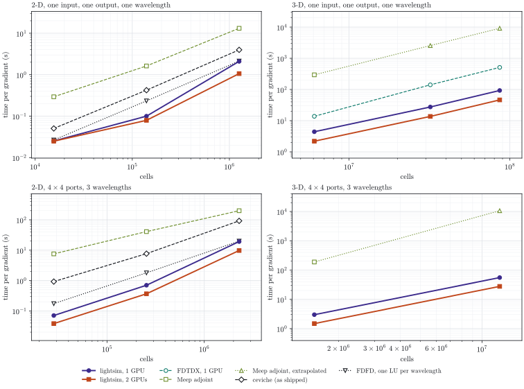

# Benchmarks

**What lightsim is compared with.** Open-source solvers (FDTDX, Meep,
ceviche) are run on the same hardware with the same scenes, and their
numbers are measurements. Commercial solvers are not run: they appear only
through figures their vendors publish, and are marked as such.

Vacuum box with 12-cell CPML on all faces and a dipole, f32, best of runs
(`benchmarks/speed/sweep.py`, which calls `lightsim bench` and
`benchmarks/speed/fdtdx_box.py`). Each run takes 200 steps, or more on small grids so
that it does at least 2×10¹⁰ cell updates. Gcells/s = 10⁹ cell updates per
second. In the figure lightsim is solid and FDTDX dashed, on the same GPUs; the
star is a published Lumerical figure on a different GPU, not a measurement
of ours.

**lightsim build and method.** Every lightsim number in the tables above
"2-D simulations" (except the RTX PRO 6000 vacuum-box table, the GB10
vacuum-box table, the feature-scene table and the multi-node GB10 rows, re-measured with later
commits as said under them) was measured with lightsim 0.1.0 (commit 37601a2, built
from a fresh clone with `cargo build --release` and `maturin develop
--release`). Each timing was taken at least three times, each time in a new
process, and the best is reported; a run counted only if the GPUs it used
were idle just before it started. Every lightsim run ended with finite fields
(the runner checks the field energy at the end of a run and fails the run
otherwise). The spread between runs is under 3 % except where a note says
otherwise. FDTDX 0.6.3 (JAX 0.12.1) has not changed; for each table it is said
which FDTDX rows were re-measured with this build and which are carried over
from the earlier measurements.

**NVIDIA RTX PRO 6000 Blackwell Max-Q (sm_120)**

| grid | cells | lightsim 1 GPU | FDTDX 1 GPU | speed-up | lightsim 2 GPUs | FDTDX 2 GPUs | speed-up |
|---|---|---|---|---|---|---|---|
| 128³ | 2.1 M | 25.9 | 21.7 | 1.19× | 23.2 | 4.33 | 5.36× |
| 192³ | 7.1 M | 22.3 | 13.7 | 1.63× | 29.9 | 7.64 | 3.91× |
| 256³ | 16.8 M | 23.9 | 10.9 | 2.19× | 37.4 | 9.81 | 3.81× |
| 320³ | 32.8 M | 25.0 | 10.9 | 2.30× | 41.4 | 12.1 | 3.42× |
| 400³ | 64 M | 25.6 | 11.1 | 2.31× | 45.2 | 14.4 | 3.14× |
| 512³ | 134 M | 26.4 | 11.2 | 2.35× | 49.3 | 17.0 | 2.90× |
| 640×640×512 | 210 M | 27.1 | 11.3 | 2.39× | 50.8 | 19.1 | 2.66× |
| 1024×640×640 | 419 M | 27.4 | 11.5 | 2.38× | 52.6 | 23.9 | 2.20× |
| 1600×800×800 | 1.02 B | | | | 53.1 | 27.8 | 1.91× |

lightsim re-measured on 2026-11-26 with commit a504a78, which gives the
fused step tiles that fill the 188 SMs evenly on small grids; each row was
run three times, alternating with the previous build in the same session
(spread under 1 % on every row). Against the previous build: 128³ 22.8 →
25.9 and 192³ 19.6 → 22.3 on one GPU, 192³ 26.4 → 29.9 on two, 1–4 % from
256³ up, 512³ equal. At 128³ the card runs at its 300 W power limit after about 2000
steps (its clock falls from about 2.3 to 2.1 GHz), which is why a step
takes longer in a long run than in a short one.

The grids whose y–z plane holds more cells than the 188 SMs take in one
wave of 1024-thread blocks (512³ and larger) were measured again with
commit 9d9370e, which gives them 32 × 32 tiles and 2-plane x-chunks: three
runs per row alternating with main (05360a4) in one session, spread under
0.3 %. 1600×800×800 on two GPUs 49.5 → 53.1 (+7.2 %; it was 1.6 % slower
with a504a78), 800³ on one GPU (not in the table) 25.0 → 26.8, the other
rows 0.2–0.8 % faster; the rows from 128³ to 400³ keep their tiles (same
code; their new runs are within the run-to-run spread of main's), and the
table keeps their earlier values. Bloch-periodic runs keep the previous tiles (commit 1386435): with
their 512-thread blocks the 2-plane chunks were 9 % slower.

FDTDX re-measured (earlier, with the previous lightsim build): 128³, 512³ and 1024×640×640 on one GPU and 512³ on two
(within 1 % of the earlier values: 21.7 against 21.9, 11.25 against 11.25,
11.49 against 11.48, 17.01 against 17.01 Gcells/s); the other FDTDX rows are
carried over.

On one GPU FDTDX comes closest on the smallest box (lightsim 1.19×) and
falls to about 11 Gcells/s on larger ones, where lightsim holds 22–27. With
two GPUs visible FDTDX is slow on small grids and keeps gaining with size,
so lightsim's lead narrows from 5.4× to 1.9×.

**NVIDIA GB10 (sm_121)**

| grid | cells | lightsim | FDTDX | speed-up |
|---|---|---|---|---|
| 128³ | 2.1 M | 2.97 | 1.56 | 1.90× |
| 192³ | 7.1 M | 3.32 | 1.58 | 2.10× |
| 256³ | 16.8 M | 3.52 | 1.60 | 2.20× |
| 320³ | 32.8 M | 3.43 | 1.66 | 2.07× |
| 400³ | 64 M | 3.58 | 1.69 | 2.12× |
| 512³ | 134 M | 3.76 | 1.70 | 2.21× |
| 640×640×512 | 210 M | 3.80 | 1.71 | 2.22× |

lightsim re-measured on 2026-11-27 with commit d9344b6: three runs per row
in rotation on a reserved GPU, spread under 1 %; 0.3–1.4 % faster than
lightsim 0.1.0 on every row (`benchmarks/speed/results/sweep_gb10_1gpu.json`
keeps the 0.1.0 values beside the new ones). FDTDX re-measured earlier: 512³
(1.70 against 1.71 Gcells/s); the other FDTDX rows are carried over.

**Several GB10 nodes** (one GB10 per node, direct 200 GbE QSFP links between neighbours). lightsim
exchanges halos over TCP; FDTDX runs one JAX process per node
(`benchmarks/speed/fdtdx_multinode.py`) with NCCL over RDMA (RoCE on both halves of
the ConnectX-7 link) — its fastest transport — or over TCP sockets:

| nodes | grid | cells | lightsim | FDTDX (NCCL RDMA) | FDTDX (NCCL sockets) | speed-up |
|---|---|---|---|---|---|---|
| 2 | 1200×640×512 | 393 M | 6.88 | 4.57 | 2.52 | 1.51× (2.73× vs sockets) |
| 2 | 1800×800×800 | 1.15 B | 7.28 | 4.36 | | 1.67× |
| 3 | 1200×640×512 | 393 M | 9.79 (200 GbE) / 9.42 (10 GbE) | — | 0.79 (10 GbE) | 11.9× (same 10 GbE network) |
| 3 | 1800×800×800 | 1.15 B | 10.50 (200 GbE) / 10.18 (10 GbE) | — | 1.13 (10 GbE) | 9.0× (same 10 GbE network) |

lightsim re-measured on 2026-11-27 with commit d9344b6 (its multi-node
stepping is the code of f2f78e1): all three nodes reserved, three runs per
row in rotation, best shown; runs during which another process was on a
node's GPU were dropped
(`benchmarks/speed/results/multinode_gb10_d9344b6.json`). Every row is within
1.3 % of lightsim 0.1.0 (6.95, 7.31, 9.80 / 9.54 and 10.64 / 10.20 Gcells/s),
inside the spread between runs, and slightly lower on all six.

FDTDX re-measured: the 2-node 393 M-cell runs. Over RDMA the best of two
launches is 4.55 Gcells/s against 4.57 (the first launch reached 4.15), over
sockets 2.48 against 2.52; the final field is the same as before (Σ E² =
2.482678). The FDTDX values in the table are the earlier ones; the other
FDTDX rows are carried over.

Parallel efficiency here is the multi-node rate divided by the number of
nodes times one GB10 on one node's slab (600×640×512 and 900×800×800 for two
nodes, 400×640×512 and 600×800×800 for three; 3.75–3.81 Gcells/s). lightsim
scales at 91–96 % on two nodes and 87–93 % on three over the 200 GbE links
(84–90 % over 10 GbE); on three nodes it runs 2.56× and 2.83× faster than one
GB10 on the same grid (3.82 and 3.71 Gcells/s). The spread between runs is
under 2.5 %. (lightsim 0.1.0 was 16–18 % faster across nodes than the build
before it.) FDTDX scales
superlinearly from one to two nodes (1.73 → 4.57 Gcells/s on the same 393
M-cell grid; the final fields agree to f32 rounding, Σ E² = 2.482678 in both
runs), which narrows the gap to 1.5–1.7×. On three nodes FDTDX runs over the
10 GbE Ethernet network with NCCL sockets: the nodes are cabled as a triangle
with a separate subnet per 200 GbE link, and NCCL needs every rank reachable
at one address, so it cannot use those links. The 3-node FDTDX run reproduces
its single-node final field (Σ E² = 2.482678) but is slower than one node,
because every step's halo crosses 10 GbE. lightsim reaches 9.5–10.2
Gcells/s on that same network, and 9.8–10.6 over the 200 GbE links (its
`--chain-addrs` gives each link its own address).

**Feature scenes** (`lightsim bench --scene ...`, `benchmarks/speed/fdtdx_scenes.py`;
same grid, materials, boundaries and source in both codes, 200 steps, Gcells/s):

| scene | GPU(s) | grid | lightsim | FDTDX | speed-up |
|---|---|---|---|---|---|
| whole domain Lorentz-dispersive | 1× RTX PRO 6000 | 400³ | 14.00 | 5.23 | 2.68× |
| | 1× RTX PRO 6000 | 640×640×512 | 16.03 | 5.29 | 3.03× |
| | 2× RTX PRO 6000 | 640×640×512 | 30.72 | 9.72 | 3.16× |
| | GB10 | 400³ | 2.09 | 0.80 | 2.61× |
| Bloch k ≠ 0 along x and y (complex fields) | 1× RTX PRO 6000 | 400³ | 11.03 | 3.92 | 2.81× |
| | 1× RTX PRO 6000 | 640×640×512 | 11.50 | 3.94 | 2.92× |
| | 2× RTX PRO 6000 | 640×640×512 | 22.40 | 6.56 | 3.41× |
| | GB10 | 400³ | 1.71 | 0.55 | 3.13× |
| rotated crystal (off-diagonal ε everywhere) | 1× RTX PRO 6000 | 400³ | 6.22 | 0.85 | 7.3× |
| | 1× RTX PRO 6000 | 640×640×512 | 6.33 | 0.73 | 8.7× |
| | 2× RTX PRO 6000 | 640×640×512 | 12.23 | 0.69 | 17.7× |
| | GB10 | 400³ | 0.96 | 0.14 | 6.7× |

FDTDX re-measured: the three 400³ rows on one RTX PRO 6000 (5.23, 3.92 and
0.852 Gcells/s, within 0.2 % of the earlier values); the other FDTDX rows are
carried over. Every lightsim row was re-measured on 2026-11-27 with commit
d9344b6, three runs each in new processes on reserved GPUs: the GB10 rows
(spread under 0.3 %) within 1 % of lightsim 0.1.0, the RTX PRO 6000 rows
(spread under 1.7 %) 0.3–3.5 % faster than 0.1.0, and 18 % faster on the
Bloch scene at 400³ (11.03 against 9.36 Gcells/s)
(`benchmarks/speed/results/recheck_rtx_feat_d9344b6.jsonl`,
`benchmarks/speed/results/recheck_gb10_d9344b6.jsonl`). lightsim 0.1.0 was
1.49–1.63× faster than the build before it on the Lorentz scene, 1.20–1.42× on
the Bloch scene and 1.16–1.18× on the rotated crystal.

Dispersive media use a dense per-cell pole state when most of a slab is
dispersive (one pass after the fused step, no index lists). Small dispersive
objects keep sparse lists. All FDTDX runs ended with finite fields.

The fused kernel computes H and E of a step in one pass (tile-marching blocks,
shared-memory H halo, double-buffered fields and CPML state, u32 material index)
and moves ~52 bytes per cell-update instead of ~84; on the RTX PRO 6000 it
reaches ~75 % of the measured copy bandwidth (1.49 TB/s).

**Inverse-design gradients** (`benchmarks/gradients/lightsim_gradient.py`,
`benchmarks/gradients/fdtdx_gradient.py`; one RTX PRO 6000). The scene is a straight
silicon waveguide through a 1.6 × 1.6 × 0.4 µm design region on a 20 nm grid,
with identical cell and step counts in both codes. FDTDX differentiates
`run_fdtd` with `jax.value_and_grad`: reversible time stepping with the
recorder settings from its own optimization example. lightsim uses its adjoint
method: a forward run plus an adjoint run.

| cells × steps | lightsim forward | FDTDX forward | lightsim gradient | FDTDX gradient | gradient speed-up |
|---|---|---|---|---|---|
| 6.0 M × 2 623 | 1.07 s | 3.01 s | 2.18 s | 10.74 s | 4.9× |
| 32 M × 3 934 | 7.05 s | 34.34 s | 13.85 s | 102.57 s | 7.4× |

lightsim: commit df2b0b5 (2026-11-27), the run with the fastest gradient of three
runs, each the best of three in one process, alternating with 0.1.0 (gradients
2.37 s and 14.03 s that day); FDTDX carried over (not re-measured).
These two rows use FDTDX's recorder settings from its own example. The wider
comparison [below](#inverse-design-time-per-gradient-against-other-tools)
checks every gradient against finite differences, finds that recorder 7–23 %
off, and times FDTDX with a 16-bit recorder that passes.

lightsim's time reversal (`lightsim_core::reverse`, CPU and GPU) steps a
16.8 M-cell box backwards at 12.6 Gcells/s on one RTX PRO 6000 (forward
20.7), reconstructing the fields to 8e-7. (The earlier build: 13.2 backwards,
18.2 forwards.)

**Gradients inside the engine** (`benchmarks/gradients/lightsim_autodiff.py`, one RTX
PRO 6000; module notes in [docs/modules/autodiff.md](modules/autodiff.md)).
Time for one gradient with respect to the samples of an index-grid design,
three ways: `lightsim.invdes` driving every run from Python
(`engine="python"`), the same S-matrix gradient in the persistent Rust session
(`engine="native"`: scene rasterised once, design sub-block uploaded, adjoint
product on the GPU), and reverse-mode differentiation through the time loop
of a time-domain objective (energy through the output plane). The two
S-matrix engines return the same numbers (S to 5e-16, gradient to 1.0e-7).

| scene | Python path | native session | speed-up | reverse mode (forward + reverse pass) |
|---|---|---|---|---|
| 2.5-D, 23 k cells, 2 inputs × 2 outputs × 3 frequencies (4 runs × 2 000 steps) | 0.622 s | 0.067 s | 9.3× | |
| gradient scene, 6.0 M × 2 623, 137 781 design samples | 2.39 s | 2.05 s | 1.16× | 4.30 s (1.15 + 3.07) |
| gradient scene, 32 M × 3 934, 137 781 design samples | 14.51 s | 12.24 s | 1.19× | 30.19 s (6.55 + 23.49) |

The two gradient-scene rows: commit df2b0b5 (2026-11-27), each column the best
of three runs, alternating with 0.1.0, which took 2.63 / 2.05 / 4.26 s (6 M)
and 15.08 / 12.26 / 29.41 s (32 M) that day: its reverse pass at 32 M is 2.6 %
faster than df2b0b5's. The 2.5-D row is carried over from 0.1.0.

Where the time goes. The small problem is a one-cell-thick grid, which
lightsim 0.1.0 steps with its 2-D update (about 8 µs per step in both
engines); the Python path also pays a set-up per run (spec, rasterisation,
device allocation, PTX load): 0.56 s of its 0.62 s. In the large scenes the
simulations themselves dominate (2 × 1.01 s of the 2.05 s at 6 M) and the
session saves the per-run set-up and the host-side product. Session set-up,
once: 0.14 s, 0.19 s and 1.65 s for the three scenes.

Reverse mode costs a forward run plus a reverse pass of 2.7 (6 M) to 3.6
(32 M) times that. Per step the pass reverses the forward fields and
advances the adjoint, both with the split kernels (the adjoint needs the
transposed CPML, which the fused kernel does not contain), and accumulates
the coefficient sums. It records the one-cell PML shell on the device:
5.2 GB at 6 M, 27.7 GB at 32 M. Its gradient agrees with central finite
differences of the objective to 4e-5 (6 M) and 3e-4 (32 M). With the adjoint
on the fused kernel and the forward CPML in place of its transpose the pass
took 2.41 s and 16.0 s on the earlier build, and the 6 M gradient was off by
1.4 %; that version was dropped. On the same two scenes FDTDX's reversible
`jax.value_and_grad` takes 10.74 s and 102.57 s
(`benchmarks/gradients/results/fdtdx_gradient_*.json`), and `lightsim.adjoint` (uniform
design block, gradient per Yee cell, two Python-driven runs) 2.42 s and
14.0 s.

**FDTDX's own speed benchmark** (SOI directional coupler from FDTDX's
`performance/coupler.gds`, non-uniform grid, mode source and three mode
detectors; same grid and number of steps in both codes,
`benchmarks/speed/lightsim_coupler.py`):

| GPU | cells/λ | grid | lightsim | FDTDX | speed-up |
|---|---|---|---|---|---|
| RTX PRO 6000 | 10 | 948×145×65 | 7.08 s | 25.1 s | 3.55× |
| RTX PRO 6000 | 20 | 1897×291×128 | 73.0 s | 426.0 s | 5.84× |
| RTX PRO 6000 | 30 (4000 steps) | 2845×436×193 | 41.5 s | 247.0 s | 5.95× |
| GB10 | 10 | 948×145×65 | 39.4 s | 190.2 s | 4.82× |
| GB10 | 20 (4000 steps) | 1897×291×128 | 82.8 s | 470.1 s | 5.68× |

lightsim on the RTX PRO 6000: commit df2b0b5 (2026-11-27), best of three runs
(`benchmarks/speed/results/coupler_lightsim_rtx6000_*_df2b0b5*.json`; 0.1.0
took 7.06, 73.2 and 43.6 s). On the GB10: 0.1.0 (commit 37601a2).

The whole FDTDX column was re-measured: the GB10 run at 10 cells/λ took
190.2 s against the earlier 200.6 s (5.2 % faster), more than the 5 % allowed
for carrying values over. The other FDTDX rows moved by 3 % or less (RTX PRO
6000: 25.1 against 24.4 s at 10 cells/λ, 426.0 against 425.8 s, 247.0 against
246.9 s; GB10 at 20 cells/λ: 470.1 against 482.8 s). lightsim takes 14–24 %
less time than with the earlier build.

lightsim's coupler transmissions are converged to ~2 % between 10 and 20
cells/λ (T_thru/T_cross 0.571/0.425 → 0.555/0.442, unchanged from the earlier
build and the same on both GPUs), whereas FDTDX's swing from 0.25/0.72 to
0.92/0.07 at these meshes. Full tables: `benchmarks/speed/results/summary.md` in the repository.

## The current code against FDTDX, one session

The tables above were measured with lightsim 0.1.0. Since then the solver
gained the media, sources and gradient engines listed in
[Features](features.md). To check that nothing slowed down, every large scene
was measured again at commit `a31efc1`, with lightsim and FDTDX 0.6.3 in the
same session on the same GPUs, reserved for the session. lightsim: best of
three runs, each in a new process. FDTDX: best of two repetitions in one
process (one for the coupler). Gcells/s unless a time is given. Every run:
`benchmarks/speed/results/head_recheck.json`.

**NVIDIA RTX PRO 6000 Blackwell Max-Q**

| scene | GPUs | grid | lightsim | FDTDX | speed-up |
|---|---|---|---|---|---|
| vacuum box | 1 | 512³ | 26.39 | 11.26 | 2.34× |
| | 1 | 640×640×512 | 26.57 | 11.17 | 2.38× |
| | 1 | 1024×640×640 | 26.40 | 11.32 | 2.33× |
| | 2 | 512³ | 48.62 | 16.85 | 2.88× |
| | 2 | 1024×640×640 | 50.79 | 23.49 | 2.16× |
| | 2 | 1600×800×800 | 50.31 | 27.73 | 1.81× |
| whole domain Lorentz-dispersive | 1 | 400³ | 13.77 | 5.23 | 2.63× |
| | 1 | 640×640×512 | 15.49 | 5.28 | 2.93× |
| | 2 | 640×640×512 | 29.88 | 9.53 | 3.14× |
| Bloch k ≠ 0 (complex fields) | 1 | 400³ | 9.28 | 3.91 | 2.37× |
| | 1 | 640×640×512 | 11.12 | 3.94 | 2.82× |
| | 2 | 640×640×512 | 21.45 | 6.58 | 3.26× |
| rotated crystal (off-diagonal ε) | 1 | 400³ | 6.16 | 0.88 | 7.0× |
| | 1 | 640×640×512 | 6.31 | 0.74 | 8.5× |
| | 2 | 640×640×512 | 12.16 | 0.69 | 17.5× |
| gradient, 6.0 M cells × 2 623 steps | 1 | 400×200×75 | 2.41 s | 10.81 s | 4.5× |
| gradient, 32 M cells × 3 934 steps | 1 | 800×400×100 | 14.42 s | 103.1 s | 7.1× |
| FDTDX's coupler, 10 cells/λ | 1 | 948×145×65 | 6.97 s | 24.89 s | 3.57× |
| FDTDX's coupler, 20 cells/λ | 1 | 1897×291×128 | 73.25 s | 425.6 s | 5.81× |
| FDTDX's coupler, 30 cells/λ, 4000 steps | 1 | 2845×436×193 | 43.61 s | 246.8 s | 5.66× |

**NVIDIA GB10**

| scene | grid | lightsim | FDTDX | speed-up |
|---|---|---|---|---|
| vacuum box | 512³ | 3.73 | 1.70 | 2.20× |
| | 640×640×512 | 3.78 | 1.66 | 2.27× |
| whole domain Lorentz-dispersive | 400³ | 2.08 | 0.78 | 2.65× |
| Bloch k ≠ 0 (complex fields) | 400³ | 1.70 | 0.53 | 3.21× |
| rotated crystal (off-diagonal ε) | 400³ | 0.95 | 0.14 | 6.8× |
| FDTDX's coupler, 10 cells/λ | 948×145×65 | 39.46 s | 200.7 s | 5.09× |
| FDTDX's coupler, 20 cells/λ, 4000 steps | 1897×291×128 | 82.68 s | 485.0 s | 5.87× |

**Several GB10 nodes** (lightsim only; the FDTDX column is carried over from
the table above, because its multi-node set-up was not run again)

| nodes, network | grid | lightsim | FDTDX | speed-up |
|---|---|---|---|---|
| 2, 200 GbE links | 1200×640×512 | 6.88 | 4.57 (NCCL RDMA) | 1.51× |
| 2, 200 GbE links | 1800×800×800 | 7.28 | 4.36 (NCCL RDMA) | 1.67× |
| 3, 200 GbE links | 1200×640×512 | 9.79 | — | |
| 3, 10 GbE | 1200×640×512 | 9.42 | 0.79 (NCCL sockets) | 11.9× |
| 3, 200 GbE links | 1800×800×800 | 10.50 | — | |
| 3, 10 GbE | 1800×800×800 | 10.18 | 1.13 (NCCL sockets) | 9.0× |

The lightsim column of this table was measured again on 2026-11-27 with
commit d9344b6 (same runs as the table further up); the values of the
a31efc1 session were 6.91, 7.19, 9.85, 9.44, 10.61 and 10.18 Gcells/s.

lightsim is faster than FDTDX on every row: 1.8–2.9× on the vacuum box,
2.4–3.3× on the dispersive and Bloch scenes, 7–17× on the rotated crystal,
3.6–5.9× on FDTDX's own coupler benchmark, 4.5–7.1× per gradient and 1.5–12×
across nodes. Against the 0.1.0 numbers above, lightsim is within 2 % on every
row. The largest differences: the 32 M gradient is 1.8 % slower (14.42
against 14.16 s), the two-node 1800×800×800 run 1.7 % lower (7.19 against
7.31), and the Bloch scene 0.8–1.0 % lower (9.28 against 9.36 Gcells/s at
400³). Run side by side afterwards, the released build and the current code
give the same Bloch-scene speed (9.35 Gcells/s both, three runs each), so
that last difference belongs to the session, not to the code.

## 2-D simulations

Square 2-D grids of 10⁴ to 10⁸ cells (12-cell CPML included), 25 nm cells,
one electric dipole per field set in use, f32, best of three runs
(`benchmarks/two_d/bench_2d.py`, which calls `lightsim bench --n N,N` and
`benchmarks/two_d/fdtdx_2d.py`). "2-D" is the specialised update of a
`dimensions=2` simulation; "one-cell 3-D route" is the same grid run through
the general 3-D update (`--kernels 3d`), which is how a 2-D problem ran
before the 2-D mode: a 3-D grid one cell thick with periodic boundaries.
"TE" updates one field set (three components), "both" the two sets (six).
Gcells/s = 10⁹ cell updates per second, whatever the number of components.

**GPU: one NVIDIA RTX PRO 6000 Blackwell Max-Q** (FDTDX 0.6.3 has no 2-D
solver; its column is the same grid as a one-cell 3-D grid with periodic
boundaries, all six components updated, best of two runs)

| cells | 2-D, TE | 2-D, both | one-cell 3-D route, TE | one-cell 3-D route, both | FDTDX (one-cell 3-D grid) |
|---|---|---|---|---|---|
| 10 000 | 1.82 | 1.30 | 0.38 | 0.36 | 0.81 |
| 99 856 | 15.9 | 11.5 | 1.57 | 1.54 | 6.95 |
| 1 000 000 | 50.1 | 31.5 | 2.27 | 2.27 | 32.5 |
| 9 998 244 | 41.7 | 25.2 | 2.19 | 2.19 | 12.3 |
| 100 000 000 | 44.4 | 27.7 | 2.05 | 2.05 | 11.9 |

On the GPU the 2-D update is 5–22× faster than the one-cell 3-D route with
one polarization and 4–14× with both: the fused 3-D kernel's blocks are 32
cells wide along the thin axis, so most of its threads idle. Against FDTDX on
the same one-cell grid lightsim is 2.2–3.7× faster with TE and 1.6–2.3× with
both polarizations, except at 10⁶ cells, where FDTDX is at its best: 1.5×
slower than lightsim with TE and level with it with both polarizations.

**CPU: AMD Ryzen Threadripper 9980X, 64 cores / 128 threads**

| cells | 2-D, TE | 2-D, both | one-cell 3-D route, TE | one-cell 3-D route, both |
|---|---|---|---|---|
| 10 000 | 0.29 | 0.22 | 0.01 | 0.01 |
| 99 856 | 0.57 | 0.28 | 0.11 | 0.11 |
| 1 000 000 | 1.04 | 0.49 | 0.67 | 0.66 |
| 9 998 244 | 1.43 | 0.78 | 1.04 | 1.03 |
| 100 000 000 | 2.94 | 1.54 | 1.63 | 1.63 |

On this CPU one polarization runs 1.4–2× faster than the one-cell route on
grids of 10⁶ cells and more, and 5–25× faster on small grids, where the
3-D route is dominated by per-step overhead. With both polarizations the
2-D update is faster below 10⁶ cells but 25 % *slower* than the 3-D route
at 10⁶–10⁷ cells and level with it at 10⁸: on 128 threads the two sets'
row loops do not split as well as the 3-D update. (On a 10-core laptop
CPU the 2-D update with both sets is 2.3× faster than the 3-D route at
10⁶ cells.) The large-grid CPU figures use 40 steps and vary by about
10 % between runs.

**Applications, before and after the 2-D path.** "Before" is the tree
without the 2-D mode (a one-cell 3-D grid on the general update), "after"
the current one; "after, 3-D kernels" is the current tree with
`LIGHTSIM_2D=0`. Time per run, best of three after a warm-up
(`benchmarks/two_d/bench_2d_apps.py`): the effective-index S-parameters of the
gdsfactory 1x2 MMI (132 628 cells, 7 000 steps, 11 wavelengths, one input
port) and one planar inverse-design gradient (solve + vector-Jacobian
product, two inputs, two outputs, three frequencies, about 2×10⁴ cells).

| | before | after | after, 3-D kernels | speed-up |
|---|---|---|---|---|
| 2.5-D MMI S-parameters, one RTX PRO 6000 | 0.668 s | 0.202 s | 0.672 s | 3.3× |
| 2.5-D MMI S-parameters, CPU (128 threads) | 8.86 s | 2.70 s | 8.18 s | 3.3× |
| planar gradient, native engine, one RTX PRO 6000 | 0.258 s | 0.069 s | 0.259 s | 3.8× |
| planar gradient, Python engine, one RTX PRO 6000 | 0.332 s | 0.125 s | 0.336 s | 2.7× |
| planar gradient, native engine, CPU (128 threads) | 8.01 s | 0.420 s | 7.34 s | 19× |
| planar gradient, Python engine, CPU (128 threads) | 8.11 s | 0.460 s | 7.01 s | 18× |

The S-parameters and the gradient's figure of merit agree between the
three columns to 4×10⁻⁶. On the CPU the 3-D update scales poorly to 128
threads on a grid this small, hence the large gain of the planar gradient.
Result files: `benchmarks/two_d/results/twod_*.json` and
`benchmarks/two_d/results/twod_apps/`.

## Inverse design: time per gradient against other tools

Wall time from a design permittivity to the gradient of the objective with
respect to every design sample, for lightsim and the other tools that do
photonic inverse design, on the same problems. Scripts, scene definitions and
the exact command behind every number: `benchmarks/invdes/README.md`. Raw
results (every timing, hardware, GPU state before and after, finite-difference
checks): `benchmarks/invdes/results/invdes_*.json`; all tables, including objective
values, memory and one-time costs: `benchmarks/invdes/results/invdes_summary.md`.

**Problems.** Silicon in oxide at 1.55 µm. `wg2d`: 2-D, one input, one
output, one wavelength, a 2.43 µm square design. `wg3d`: a 480 × 220 nm wire
through a 1.6 × 1.6 × 0.22 µm design on a 20 nm grid; the domain grows (6 M,
32 M, 86 M cells), the design does not. `mm2d` and `mm3d`: four inputs, four
outputs, three wavelengths (1.54, 1.55, 1.56 µm); the objective is the
fidelity of the 4 × 4 transmission matrix to the discrete Fourier transform.
Every tool gets the same domain, cell size, absorbing layers, port planes,
pulse, simulated time (chosen so that objective and gradient have converged)
and design (a grey, smooth pseudo-random pattern).

**Measured.** Best of at least three gradients unless a cell says otherwise;
hardware and precision per row; JAX compilation timed separately; "runs" is
the number of simulations (forward-equivalents) per gradient. GPU timings on
an otherwise idle GPU (one visible GPU for single-GPU rows); CPU timings with
nothing else running, at the fastest process or thread count tried. Hardware:
NVIDIA RTX PRO 6000 Blackwell Max-Q (96 GB) ("GPU" rows); NVIDIA GB10 ("GB10" rows, one
node, 128 GB of unified memory); AMD Threadripper 9980X, 64 cores.

**lightsim build.** The line under each table names the build its lightsim
rows were measured with. lightsim 0.1.0 rows: the 2-D rows with commit 54e0973, which steps one-cell-thick grids with its 2-D
update, the 3-D rows with commit 37601a2 (the released head). The 2-D mode is
what changed the 2-D rows: on the largest single-wavelength scene (1.26 M
cells) one native-engine gradient took 53.0 s with the earlier build's default
kernels (4.95 s with its split kernels) and takes 2.27 s on 0.1.0. Against the
earlier build the 3-D single-port rows are 0.6–5 % faster and the 3-D
multi-port rows 10–36 % faster; the objective of the 6 M and 32 M single-port
scenes moved by 1 % (0.2072 → 0.2094 and 0.2105 → 0.2126; 86 M: 0.2132 in
both), and the finite-difference checks below are those of 37601a2.

**Gradient check.** Each tool's gradient is compared with central finite
differences of the same tool's objective: worst of several small patches of
design samples (relative to the largest derivative), and the derivative along
a smooth direction over the whole design ("patch / direction"). On the
multi-port scenes the direction check is 3–6 % in every tool alike: the
objective is the squared sum of 16 phasors that nearly cancel, and the finite
difference itself is not linear at that step. On the coarsest 2-D grid the
single-sample patch is at the single-precision noise of the GPU tools (5.6 %).
"–": not checked on that scene (too slow); the tool was checked on the smaller
scenes of the family.

### 2-D, one input, one output, one wavelength

| tool | hardware, precision | 15.6 k cells × 4 759 steps | 140 k × 14 276 | 1.26 M × 42 826 | runs | gradient check (45 / 15 / 5 nm) |
|---|---|---|---|---|---|---|
| lightsim, native engine | 1 GPU, single | **0.025 s** | 0.100 s | 2.10 s | 1 + 1 | 5.6 % / 0.13 %; 0.12 % / 2e-4; 0.78 % / 0.17 % |
| lightsim, Python engine | 1 GPU, single | 0.057 s | 0.267 s | 2.31 s | 1 + 1 | same gradient as native |
| lightsim, reverse mode¹ | 1 GPU, single | 0.345 s | 1.14 s | 7.24 s | 1 + 1 reverse | 3e-5 / 0.13 %; 8e-6 / 0.12 %; 9e-6 / 0.12 % |
| lightsim, native engine | 2 GPUs, single | **0.025 s** | **0.079 s** | **1.06 s** | 1 + 1 | |
| lightsim, Python engine | 2 GPUs, single | 0.031 s | 0.171 s | 1.20 s | 1 + 1 | |
| lightsim, native engine | 1 GB10, single | 0.034 s | 0.235 s | 20.3 s | 1 + 1 | |
| lightsim, Python engine | 1 GB10, single | 0.073 s | 0.429 s | 19.5 s | 1 + 1 | |
| Meep 1.35.1 adjoint | CPU, 64 cores, double | 0.293 s (4 proc.) | 1.62 s (16 proc.) | 13.2 s (64 proc.) | 1 + 1 | 0.16 % / 0.45 %; 6e-4 / 2e-4; 0.83 % / 0.17 % |
| ceviche 0.1.3 (FDFD, as shipped) | CPU, 64 cores, double | 0.050 s | 0.423 s | 3.97 s | 1 + 1 factorisations | 4e-5 / 0.59 %; 3e-5 / 0.11 %; 6e-5 / 8e-4 |
| FDFD, one LU per wavelength² | CPU, 64 cores, double | 0.027 s | 0.233 s | 2.13 s | 1 factorisation | as ceviche |
| FDTDX | — | not run³ | | | | |

lightsim rows measured with commit f2f78e1 on 2026-11-27 (timing runs, which skip the finite differences;
the gradient checks are those of lightsim 0.1.0); Meep and ceviche rows carried over from 2026-11-22.
The GB10 rows (same commit, 2026-11-27) are each the best of three gradients, every run with no
other process on the GB10.

### 2-D, 4 inputs × 4 outputs × 3 wavelengths

| tool | hardware, precision | 28.2 k cells × 5 711 steps | 254 k × 17 131 | 2.29 M × 51 391 | runs | gradient check (45 / 15 / 5 nm) |
|---|---|---|---|---|---|---|
| lightsim, native engine | 1 GPU, single | 0.071 s | 0.701 s | 19.2 s | 4 + 4 | 2.1 % / 5.8 %; 0.69 % / 4.1 %; 2e-4 / 3.5 % |
| lightsim, Python engine | 1 GPU, single | 0.303 s | 1.47 s | 22.5 s | 4 + 4 | same gradient as native |
| lightsim, native engine | 2 GPUs, single | **0.038 s** | **0.367 s** | **9.76 s** | 4 + 4 | |
| lightsim, Python engine | 2 GPUs, single | 0.162 s | 0.832 s | 11.6 s | 4 + 4 | |
| lightsim, native engine | 1 GB10, single | 0.110 s | 2.60 s | 177 s | 4 + 4 | |
| lightsim, Python engine | 1 GB10, single | 0.389 s | 2.96 s | 180 s | 4 + 4 | |
| Meep adjoint | CPU, 64 cores, double | 7.56 s (16 proc.) | 40.9 s (64 proc.) | 199 s (64 proc., 1 run) | 4 + 4⁴ | 0.41 % / 4.4 %; 0.74 % / 4.4 %; – / 3.5 % |
| ceviche (as shipped) | CPU, 64 cores, double | 0.926 s | 7.68 s | 92.3 s (2 runs) | 12 + 12 factorisations | 5e-5 / 3.7 %; 6e-5 / 3.4 %; – |
| FDFD, one LU per wavelength² | CPU, 64 cores, double | 0.174 s | 1.79 s | 19.9 s | 3 factorisations | 5e-5 / 3.7 %; 6e-5 / 3.4 %; 7e-5 / 2.8 % |

lightsim rows measured with commit f2f78e1 on 2026-11-27 (timing runs, which skip the finite differences;
the gradient checks are those of lightsim 0.1.0); Meep and ceviche rows carried over from 2026-11-22. The
one-GPU native gradient at 2.29 M cells was published as 18.5 s with 0.1.0; 0.1.0 itself takes 19.4 s on the
same card today, alternating with the current code in one session (19.2 s), so today's number replaces it.
The GB10 rows (same commit, 2026-11-27) are each the best of three gradients, every run with no other
process on the GB10.

### 3-D, one input, one output, one wavelength

| tool | hardware, precision | 6.08 M cells × 5 770 steps | 32 M × 8 917 | 86.4 M × 12 064 | runs | gradient check (6 / 32 / 86 M) |
|---|---|---|---|---|---|---|
| lightsim, native engine | 1 GPU, single | 4.41 s | 27.4 s | 92.8 s | 1 + 1 | 0.33 % / 0.27 %; 3e-4 / 0.17 %; – / 0.22 % |
| lightsim, Python engine | 1 GPU, single | 4.60 s | 29.6 s | 96.7 s | 1 + 1 | same gradient as native |
| lightsim, reverse mode¹ | 1 GPU, single | 10.4 s | 73.7 s | out of memory⁵ | 1 + 1 reverse | 5e-4 / 0.14 %; 5e-4 / 0.15 %; – |
| lightsim, native engine | 2 GPUs, single | **2.20 s** | **13.7 s** | **46.3 s** | 1 + 1 | |
| FDTDX 0.6.3, 16-bit recorder⁶ | 1 GPU, single | 13.4 s (compile 2.6 s) | 141 s (compile 2.1 s) | 509 s (1 run; every 10th step⁶; compile 2.6 s) | 1 + 1 reverse | 0.55 % / 0.29 %; – / 0.33 %; – |
| FDTDX, exact recorder | 1 GPU, single | 13.8 s (compile 2.4 s) | does not fit⁶ | | 1 + 1 reverse | 7e-4 / 9e-4 |
| FDTDX, 8-bit recorder of its examples | 1 GPU, single | 13.6 s (compile 2.7 s) | 142 s (compile 2.5 s) | | 1 + 1 reverse | **7.7 % / 6.9 %; – / 23 %** (fails) |
| Meep adjoint | CPU, 64 cores, double | 295 s (64 proc.) | ~2 550 s, extrapolated⁷ (417 M cells/s) | ~9 150 s, extrapolated⁷ (425 M cells/s) | 1 + 1 | 0.11 % / 7e-4; –; – |

lightsim rows: commit df2b0b5 (2026-11-27), each the best of three gradients
timed in separate runs on the same card, alternating with 0.1.0 (whose own
best on this card that day: native 4.44 / 27.2 / 92.5 s, Python 4.71 / 29.6
/ 97.2 s, reverse 10.3 / 73.0 s; two GPUs 2.22 / 13.7 / 46.3 s). The
gradient checks are those of 0.1.0 (commit 37601a2); the launch shape does
not change the arithmetic: df2b0b5's gradients equal those of the build
before it bit for bit.

### 3-D, 4 inputs × 4 outputs × 3 wavelengths

| tool | hardware, precision | 1.52 M cells × 4 769 steps | 12.2 M × 9 537 | runs | gradient check (44 / 22 nm) |
|---|---|---|---|---|---|
| lightsim, native engine | 1 GPU, single | 2.99 s | 55.2 s | 4 + 4 | 1.0 % / 1.9 %; 0.17 % / 0.22 % |
| lightsim, Python engine | 1 GPU, single | 3.27 s | 58.5 s | 4 + 4 | same gradient as native |
| lightsim, native engine | 2 GPUs, single | **1.48 s** | **27.7 s** | 4 + 4 | |
| lightsim, native engine | 1 GB10, single | 27.4 s | not run | 4 + 4 | |
| FDTDX, exact recorder⁸ | 1 GPU, single | 22.4 s (compile 22.4 s) | not run⁸ | 4 + 4 reverse | 3e-4 / 0.49 % |
| Meep adjoint | CPU, 64 cores, double | 188 s (64 proc.) | ~10 600 s, extrapolated⁷ (389 M cells/s) | 4 + 4⁴ | 1e-4 / 0.19 %; – |

lightsim rows measured with commit f2f78e1 on 2026-11-27 (timing runs; gradient checks of lightsim 0.1.0); FDTDX
and Meep rows carried over from 2026-11-22. The GB10 row (same commit, 2026-11-27) is the best of three
gradients, every run with no other process on the GB10; the 12.2 M-cell scene was not run there.

¹ Reverse mode differentiates a different, time-domain objective (energy
through the output plane), not the modal transmission; it is listed for its
cost, not as the same problem, and is single-port only. In 2-D it still steps
with the 3-D kernels, not the 2-D update.
² Not a ceviche feature: ceviche's operators with one sparse LU factorisation
per wavelength reused for every input and the adjoint (MKL PARDISO). It shows
what a direct frequency-domain solver can do in 2-D.
³ FDTDX 0.6.3's mode-overlap detector needs a plane at least two cells wide in
both transverse directions; on a one-cell-thick 2-D domain it raises
`Invalid ModeOverlapDetector shape: (1, 24, 1)`
(`benchmarks/invdes/results/invdes_fdtdx_2d_unsupported.txt`).
⁴ With several wavelengths Meep's adjoint source is a filtered source of
length 1/Δf (805 fs here), longer than the forward run; this is inherent to
`meep.adjoint` and is in the number.
⁵ `RuntimeError: DriverError(2, "out of memory")` in the first forward pass on
the 96 GB GPU, on the earlier build and again on 37601a2
(`benchmarks/invdes/results/invdes_lightsim_reverse_wg3d_86M_*oom.txt`); the error
does not say how much was requested. Reverse mode
records the absorbing-layer shell and peaked at 76.4 GB at 32 M cells.
⁶ FDTDX's recorder stores the boundary fields for its time-reversed backward
run. Its own examples use every 5th step in 8-bit floats; that gradient fails
the finite-difference check (7 % at 6 M, 23 % at 32 M). The exact recorder is
accurate but needs 66 GB at 6 M cells and does not fit in 96 GB at 32 M. Every
5th step in 16-bit floats is accurate (0.55 %, 0.33 %) at the same speed and
is the FDTDX number in the figure. At 86 M cells it does not fit either; that
row uses every 10th step in 16-bit floats, which is checked at 6 M cells only
(2.2 % / 1.5 %).
⁷ Not measured: a full Meep gradient there takes 40 minutes to 3 hours, and
`meep.adjoint` cannot stop a run before its sources end. The full gradient of
the smallest scene of the family (6 M, 1.5 M cells) is scaled by cells × steps
and by Meep's stepping rate measured on both scenes at 100 and 200 steps
(which agree to 2 %: constant cost per step). Check of the method: a 32 M
gradient with every run stopped at the end of its source (2 158 + 2 158 steps)
measured 675 s; the scaling predicts 618 s (9 % low). Figures in cells per
second are Meep's measured stepping rates on that scene.
⁸ FDTDX's S-matrix on the multi-port 3-D scene is not physical (the four
outputs receive 1.44 times the input power, against 0.44–0.46 in lightsim and
Meep), and its gradient map agrees poorly with the other tools (cosine 0.76).
Its gradient is correct for its own objective (it passes the finite-difference
check) and it does the same work (4 forward and 4 backward runs on the same
grid and step count), so the time is shown in the table (not in the figure), but the FDTDX set-up of this scene
is not validated, and the larger size was not run.

### Where lightsim is slower or no faster

- **Small 2-D problems on one GPU: lightsim is now ahead of the reused LU.**
  Since commit 96b3bf8 a 2-D step is one kernel launch, and since commit
  eb0bda5 a gradient session steps the independent runs of a gradient
  (forward, adjoint, every input port) side by side on one GPU when a run
  fills only part of it (small runs are limited by launches, not by the
  GPU). On one RTX PRO 6000 the smallest single-wavelength scene (15.6 k
  cells) takes 0.025 s per native-engine gradient (0.047 s one run at a time;
  same S and gradient bit for bit), against 0.027 s for one LU per wavelength
  and 0.050 s for ceviche as shipped; the smallest 4 × 4 × 3 scene (28.2 k
  cells, eight runs) takes 0.044 s (0.228 s one at a time) against 0.174 s
  for the reused LU. The margin on the smallest single-wavelength scene is
  small: 7 % (0.025 against 0.027 s). On two RTX PRO 6000 the
  single-wavelength scene takes 0.024 s as before (its forward and adjoint
  runs go to different GPUs, one each) and the 4 × 4 × 3 scene 0.037 s
  (0.115 s before).
- **Larger 2-D scenes.** On one RTX PRO 6000: 0.095 s against 0.233 s for the
  reused LU at 140 k cells (0.155 s one run at a time) and 2.11 s against
  2.13 s at 1.26 M cells (single wavelength); 0.68 s against 1.79 s at 254 k
  cells (1.02 s one at a time) and 19.2 s against 19.9 s at 2.29 M cells
  (4 × 4 × 3). From about 1 M cells a run fills the GPU, the runs go one at a
  time as before, and the reused LU is within 1–4 %. The one-GPU rows of
  2026-11-27 alternate main (d9344b6) and commit eb0bda5 in one session
  (`benchmarks/invdes/results/side_by_side_one_gpu.json`). On two GPUs the
  same rows take 0.080 s at 140 k cells and 0.35 s at 254 k cells (0.080 and
  0.52 s with main); scenes that fill a GPU run about twice as fast on two
  (`benchmarks/invdes/results/side_by_side_two_gpu.json`). lightsim is faster than ceviche as shipped at every 2-D size and
  than Meep on 64 cores at every 2-D size (4–29×). On one GB10 the same
  gradients take 0.033 s (15.6 k cells; 0.065 s with main d9344b6), 0.234 s
  (140 k; 0.312 s), 19.9 s (1.26 M; the same), 0.118 s (28.2 k, 4 × 4 × 3;
  0.316 s) and 2.4–2.6 s with either build (254 k: a run there fills the
  GB10's 48 multiprocessors, so the runs go one at a time), alternating main and
  commit eb0bda5 in one session on 2026-11-27
  (`benchmarks/invdes/results/side_by_side_gb10.json`); 177 s at 2.29 M
  cells (commit f2f78e1, 2026-11-27, every run with no other process on the GB10,
  `benchmarks/invdes/results/invdes_lightsim_native_mm2d_5nm_gb10_f2f78e1.json`).
  ceviche was not run on the GB10. The GB10 rows of the tables above
  come from separate runs of commit f2f78e1.
- **Reverse mode** is slower than the adjoint gradient (2.3–2.6× in 3-D,
  3.3–5.3× in 2-D, where it does not use the 2-D update) and needs far more
  memory (76 GB at 32 M cells; out of memory at 86 M).
- **Two GPUs** halve the time because the forward and adjoint runs go to
  different GPUs; a gradient with one forward and one adjoint run cannot use
  more. On the largest 4 × 4 × 3 2-D scene the native engine of lightsim
  0.1.0 on two GPUs (14.1 s) was slower than its Python engine (12.1 s); with
  commit f2f78e1 the native engine takes 9.76 s there and the Python engine
  11.6 s.
- In 3-D lightsim is the fastest tool measured: 3.0× (6 M cells), 5.1×
  (32 M) and 5.5× (86 M) faster than FDTDX with an accurate recorder on one GPU, and about 65×
  (6 M, measured) to 90–185× (extrapolated) faster than Meep on 64 cores.

### Not run

- **Commercial solvers** (Lumerical, Tidy3D and others) are not run here.
  lightsim is measured against open-source tools on the same hardware;
  commercial tools are compared only through figures their vendors publish
  ([last section](#lumerical-published-figures)). No published per-gradient
  timing was found for them.
- **fdtd-z** 1.1.3 (with pjz 0.0.8): does not run on this GPU. With current
  JAX it fails on import (`ImportError: cannot import name 'xla_client' from
  'jax.lib'`); with the JAX it was written for (0.4.23, CUDA 12) JAX's CUDA
  backend does not initialise on the Blackwell GPU, and on the CPU fallback
  fdtd-z has no kernel (`NotImplementedError: MLIR translation rule for
  primitive 'fdtdz' not found for platform cpu`). Its kernels are precompiled
  for compute capabilities up to 8.0
  (`benchmarks/invdes/results/invdes_fdtdz_errors.txt`).
- **FDTDX on the 2-D scenes**: see note ³.

### Fairness notes

- Precision differs: the GPU tools run in single precision, Meep and ceviche
  in double (their default builds).
- Hardware differs by nature (GPU against CPU). The CPU tools get a whole
  64-core workstation CPU at their fastest process or thread count; the GPU
  tools one (or two) workstation GPUs.
- The discretisations are each tool's own: lightsim and Meep interpolate the
  design at each Yee component and smooth the waveguide interfaces sub-pixel,
  FDTDX has one permittivity per cell and staircases; mode solvers, sources
  and monitors are each tool's own. Objective values agree to a few per cent
  on the single-port scenes between lightsim, Meep and ceviche (FDTDX's
  staircased 3-D wire transmits 0.29 against 0.21; a straight waveguide is
  normalised to 0.98–1.00 in all three 3-D tools).
- Meep's adjoint pulse was shortened to the bandwidth of the forward pulse so
  that its adjoint run has the same length as the forward run (as shipped it
  is 100 periods long).
- What one gradient includes (set-up, mode solves, compilation) differs a
  little between tools; it is listed per tool in `benchmarks/invdes/README.md`.
  One-time costs are reported separately in `invdes_summary.md`.

## S-parameters against Meep through gdsfactory's plugin

The same call, `write_sparameters_meep(component, ...)`, through gdsfactory's
Meep plugin (Meep 1.35.1, gplugins 2.1.5) and through `lightsim.gplugins`,
on five gdsfactory components in 2-D at 30 cells/µm, 1.50 to 1.60 µm, the
same indices for both. The S-parameters agree within what the mesh allows;
the comparison of the results, entry by entry, is in
[Swap test against Meep](guide/gdsfactory.md#swap-test-against-meep).
Run times in seconds: Meep as one process (as the plugin runs it), lightsim
on one RTX PRO 6000 and on a CPU. The CPU was shared with other jobs
during these runs, so Meep's times and lightsim's CPU times are upper
bounds.

| Component | Meep, 2-D | lightsim CPU, 2-D | lightsim GPU, 2-D | lightsim GPU, 3-D |
|---|---|---|---|---|
| straight | 4.1 | 0.8 | 1.8 | 8.8 |
| bend_euler | 35.7 | 1.6 | 1.5 | 12.3 |
| mmi1x2 | 177 | 17.2 | 2.7 | 17.0 |
| coupler | 1223 | 36.8 | 6.3 | 54.4 |
| crossing | 149 | 6.0 | 4.4 | 24.1 |

Meep's 3-D run of the straight took 2469 s, lightsim's 8.8 s on the GPU.
Small 2-D runs take a second or two on the GPU whatever their size (the
time of starting the device), so the CPU is as fast there.

## Lumerical (published figures)

Commercial solvers are compared on this page only through what their
vendors publish. Ansys publishes a GPU benchmark of Lumerical FDTD; here it
is set next to a lightsim run of the same kind and size.

**Ansys's figures.** Ansys publishes solver speeds for two files
([FDTD-GPU Performance Benchmarks](https://optics.ansys.com/hc/en-us/articles/53963497603347-FDTD-GPU-Performance-Benchmarks)):
`benchmark_small` (a CMOS image sensor, about 5 GB of memory) and
`benchmark_large` (a metalens, about 50 GB; Ansys does not give its cell
count, and Ozen Engineering's report of a Lumerical metalens benchmark gives
0.85 billion cells and 13.2 Gcells/s on an A100 80 GB). Solver speed in
Gcells/s (Ansys writes Mn/s), with the memory bandwidth Ansys quotes for
each card:

| Lumerical FDTD, Ansys's numbers | bandwidth | image sensor | metalens | metalens, per GB/s |
|---|---|---|---|---|
| RTX PRO 5000 Laptop | 0.90 TB/s | 8.71 | does not fit in 24 GB | 9.7 M/s (image sensor) |
| A40 | 0.70 TB/s | 6.11 | 5.97 | 8.6 M/s |
| L40 | 0.86 TB/s | | 7.11 | 8.2 M/s |
| 4 × L40 | 3.46 TB/s | | 28.9 | 8.4 M/s |
| A100 80 GB | 1.94 TB/s | | 15.1 | 7.8 M/s |
| 2 × A100 80 GB | 3.87 TB/s | | 30.0 | 7.8 M/s |
| H100 NVL | 3.9 TB/s | | 27.6 | 7.1 M/s |
| 2 × H100 NVL | 7.8 TB/s | | 52.1 | 6.7 M/s |

**A metalens in lightsim.** Ansys's files are in Lumerical's own format and
were not opened. `benchmarks/speed/lightsim_metalens.py` builds a scene of the same
kind: dielectric pillars (index 2.39, 600 nm tall, 400 nm pitch, radii from
60 to 160 nm following a hyperbolic lens phase) on a glass substrate, a plane
wave at 633 nm from the substrate, CPML on all six faces, DFT field monitors
on the focal plane and on a cross-section, a flux monitor, 20 nm cells. With
`--dispersive` the pillars carry a Lorentz pole. Run to the shutoff level at
48 M cells, the lens focuses 2.28 µm above the pillars (designed 2.4 µm) with
58 times the incident intensity. The radius-to-phase map is linear, not a
calibrated pillar library, so this is a load of the right kind and size, not
Ansys's design. Throughput over 1000 steps (400 on the GB10), best of three
runs in new processes, commit `a31efc1`:

| lightsim, measured | bandwidth | grid | cells | pillars | Gcells/s | with dispersive pillars | per GB/s |
|---|---|---|---|---|---|---|---|
| 1 × RTX PRO 6000 Max-Q | 1.79 TB/s | 800×800×590 | 378 M | 1 049 | 24.36 | | 13.6 M/s |
| 1 × RTX PRO 6000 Max-Q | 1.79 TB/s | 1200×1200×590 | 850 M | 2 521 | 24.36 | 24.07 | 13.6 M/s |
| 2 × RTX PRO 6000 Max-Q | 3.58 TB/s | 1200×1200×590 | 850 M | 2 521 | 48.08 | 47.47 | 13.4 M/s |
| 2 × RTX PRO 6000 Max-Q | 3.58 TB/s | 1600×1600×590 | 1.51 B | 4 621 | 48.43 | | 13.5 M/s |
| GB10 | 273 GB/s | 800×800×590 | 378 M | 1 049 | 3.41 | | 12.5 M/s |
| GB10 | 273 GB/s | 1200×1200×590 | 850 M | 2 521 | 3.44 | 3.41 | 12.6 M/s |

Building the 850 M-cell scene (rasterising the pillars and loading the GPU)
takes about 27 s on the workstation and 53 s on the GB10 node, once per run.

**What the two tables say.** On a metalens of 0.85 billion cells:

- One RTX PRO 6000 Max-Q runs lightsim at 24.4 Gcells/s. Ansys reports 15.1
  for Lumerical on an A100 80 GB, a card with 8 % more memory bandwidth:
  lightsim is 1.6× faster. Ansys reports 27.6 on an H100, a card with 2.2×
  the bandwidth: lightsim on the smaller card reaches 88 % of it.
- Two RTX PRO 6000 Max-Q run at 48.1 Gcells/s, against 30.0 for two A100 and
  52.1 for two H100.
- Per GB/s of memory bandwidth, which is what bounds an FDTD update,
  lightsim moves 12.5–13.6 M cells/s against 6.7–8.6 for Lumerical on the
  metalens: 1.5–2.0× more.
- On CPUs the published Lumerical figures are ahead in absolute terms:
  2.1 Gcells/s on the metalens on a 64-core two-socket server
  ([FDTD Performance Benchmarks](https://optics.ansys.com/hc/en-us/articles/4403780894355-FDTD-Performance-Benchmarks)),
  against 0.7–0.8 Gcells/s for lightsim's CPU engine on a 64-core
  workstation with four memory channels. lightsim's CPU engine is its
  reference engine; its speed is on GPUs.

This is a comparison of a measurement with published numbers, not a
head-to-head. The scenes are of the same kind and size but are not the same
file, the hardware differs, and the releases differ.
