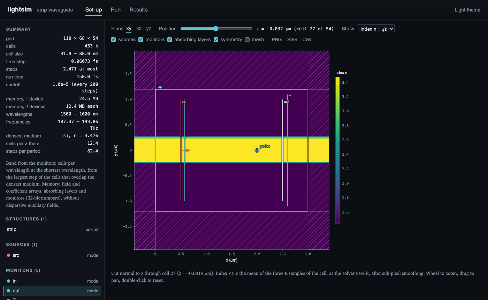
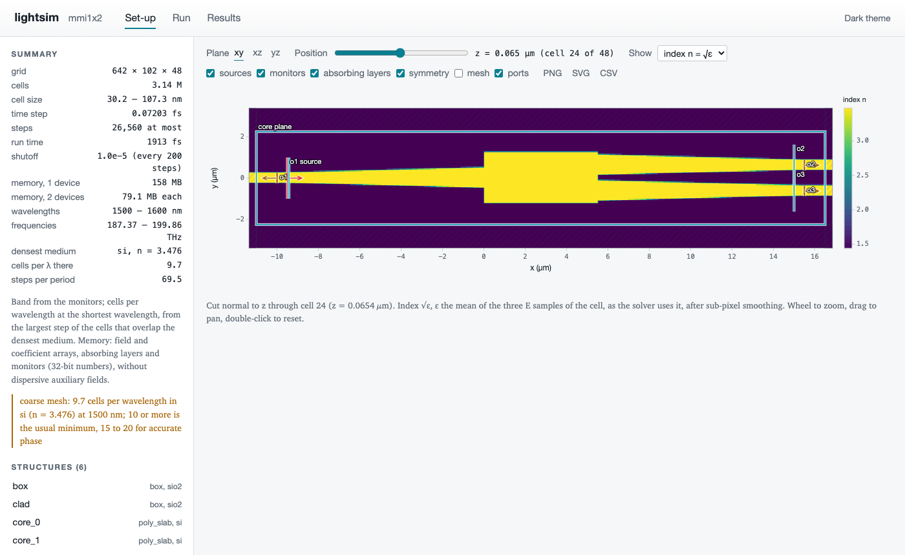
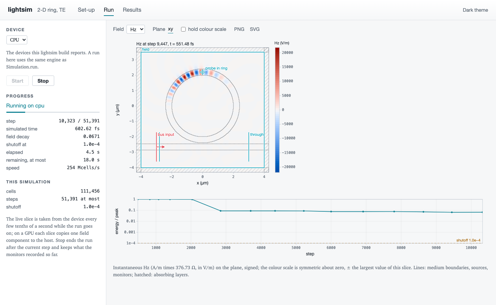
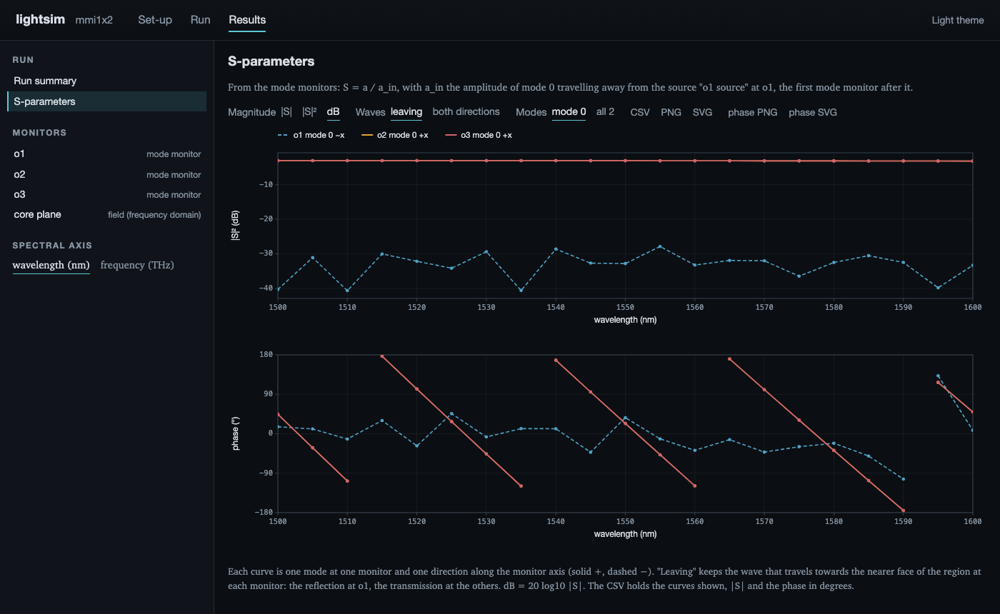
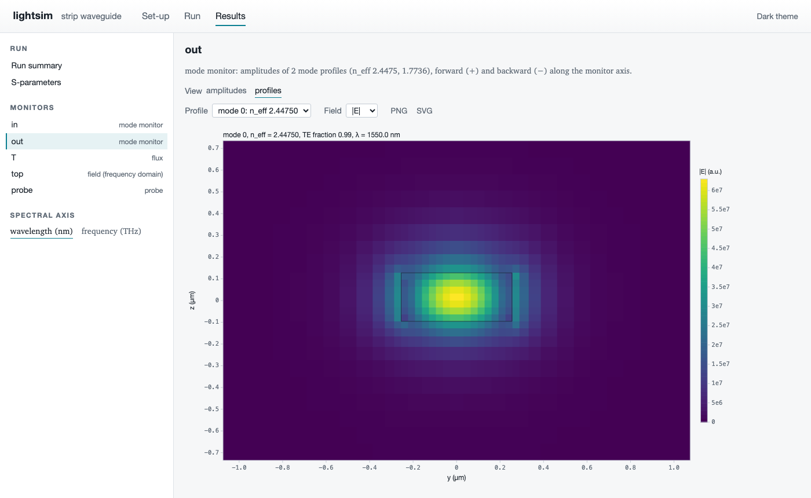
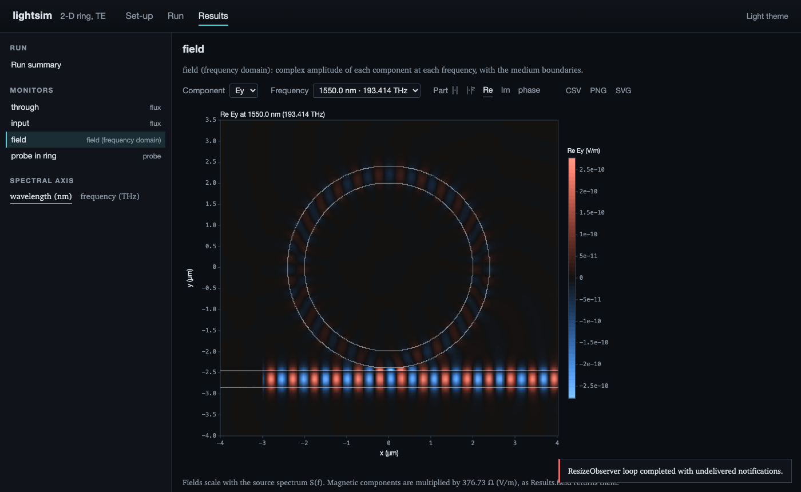
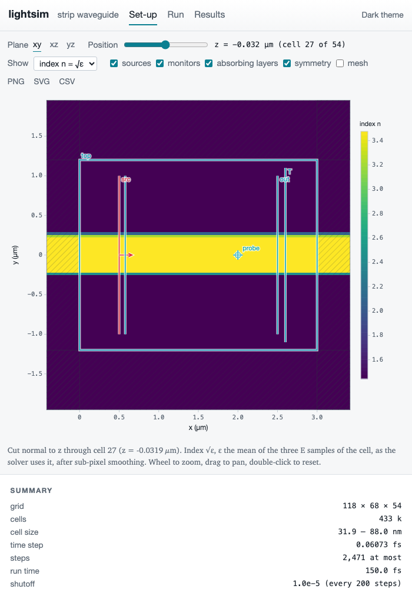

# Graphical interface

After this page you can open a simulation in a web browser to check what
will be simulated before a run, start a run and watch it, and read the
results without writing plotting code, on your own computer or on a remote
GPU machine through an SSH tunnel.

The interface is a small web application that is part of the Python
package (`lightsim.gui`). A server started from Python or from a shell
computes everything from the simulation and its results; the browser draws
it. It needs nothing beyond the package itself: the server uses the Python
standard library, the page loads no script, style sheet or font from the
network (text uses the fonts installed on your system), and nothing is
written to disk except the files you export, which the browser downloads.

## Starting it

From Python, `Simulation.view()` starts a server, prints its address and
returns it:

```text
>>> url = sim.view()
lightsim interface: http://127.0.0.1:53817/
```

`lightsim.gui.view` does the same for a simulation, its results or both:

```text
import lightsim.gui
lightsim.gui.view(sim)                 # set-up and run views
lightsim.gui.view(sim, results=res)    # all three views
lightsim.gui.view(res)                 # results only (no geometry)
```

| Argument | Meaning | Default |
|---|---|---|
| `host` | Address to listen on | `"127.0.0.1"` |
| `port` | Port | a free one |
| `open_browser` | Open the address in the default browser | when a display is available and the session is not over SSH |
| `block` | Serve until Ctrl-C (for scripts, which would otherwise end and stop the server) | `False` |
| `ports` | Port dicts as `lightsim.gds.port_info(component)` returns, drawn on the xy cuts | none |
| `title` | Name shown at the top of the page | the simulation name |

The server runs in a background thread of the Python process.
`lightsim.gui.stop()` stops every server started this way;
`lightsim.gui.serve(...)` takes the same arguments and returns the server
object (`.url`, `.stop()`) instead of printing:

```python
import lightsim as ls
import lightsim.gui
from lightsim.spec import um

sim = ls.Simulation(min=[0, 0, 0], max=[2 * um, 1 * um, 1 * um], mesh=ls.UniformMesh(50e-9), run_time=20e-15)
sim.add_source(ls.PointDipole([1 * um, 0.5 * um, 0.5 * um], "Ez", ls.GaussianPulse(2e14, 5e13)))
server = lightsim.gui.serve(sim)
print(server.url.startswith("http://127.0.0.1:"))
server.stop()
```

```text
True
```

From a shell, for a spec written by `Simulation.to_json()` and, optionally,
the results file of `lightsim run --out` (see [Command line](cli.md)):

```bash
python -m lightsim.gui spec.json
python -m lightsim.gui spec.json --results results.json --port 8765
```

`--host` and `--port` are as above, `--open` opens the browser. The command
serves until Ctrl-C. The `lightsim` program itself has no `gui` command: it
is built from Rust alone, and the interface lives in the Python package.

## On a remote GPU machine

The solver usually runs on a machine with GPUs that you reach over SSH.
Start the interface there on a fixed port and forward that port to your
computer:

```bash
ssh -L 8765:127.0.0.1:8765 user@gpu-machine
python -m lightsim.gui spec.json --port 8765        # on the remote machine
```

Then open `http://127.0.0.1:8765/` in the browser on your computer. The
server still listens only on the remote machine's loopback interface, and
the run view offers that machine's GPUs.

By default the server accepts only requests addressed to `127.0.0.1` or
`localhost`, which also keeps other web sites from reaching it through a
DNS name that points at your machine. `host="0.0.0.0"` (or `--host
0.0.0.0`) makes it reachable from the network. The printed address then
carries a random token (`?token=...`); requests without it are refused. The
connection is plain HTTP and the interface can start runs, so do this only
on a network you trust; the SSH tunnel is the safer route.

## Set-up



The set-up view shows what the solver will simulate. The picture is a cut
through the grid, normal to z, y or x (the `xy`, `xz` and `yz` links), at the
position of the slider; a 2-D simulation has its one plane. The values come
from the compiled simulation: the permittivity of the three E components of
each cell after sub-pixel smoothing, as the engine uses it, not a redrawing
of the input shapes. The choices are:

| Show | What each cell holds |
|---|---|
| index n = √ε | square root of the mean permittivity of the cell's three E samples; grey for PEC |
| ε of Ex, Ey, Ez | permittivity of one E component (ε_inf for dispersive media) |
| medium | the medium that owns the sample, with a legend |
| conductivity σ | the conductivity of that medium, in S/m (if any medium has one) |
| dispersive cells, nonlinear cells | where such media are (if there are any) |

Over the cut: sources (red) and monitors (blue) where they meet the plane,
with the direction of mode sources and plane waves; gdsfactory ports, if
given; the absorbing layers, hatched; mirror planes of the mesh and
electric or magnetic walls; and, on request, the mesh lines (every k-th line
when they would be closer than 4 pixels, as the caption says). Axes are in
µm with one µm the same length on both axes. The wheel zooms, a drag pans,
a double-click resets; hovering reads out the position, the value and the
cell index.

The side panel lists structures, sources and monitors. Selecting one shows
its parameters (lengths in µm) and highlights it; if it does not meet the
current cut, the cut moves to it. The summary gives the grid (absorbing
layers included), the number of cells, the cell sizes, the time step, the
number of steps `run_time` allows, the memory one device and two devices
need, the band of the monitors, the densest medium and the number of cells
per wavelength in it, and the steps per period. A warning appears when
there are fewer than 10 cells per shortest wavelength in the densest medium,
when there is no shutoff, no source or no monitor.

The memory estimate counts the field and coefficient arrays, the absorbing
layers and the monitors in the precision of the build; it leaves out the
auxiliary fields of dispersive and nonlinear media. Cuts are computed for
one plane at a time (only three cells around the plane are rasterised) and
sent at most 900 samples a side, every k-th cell, so large grids stay
responsive.



The MMI above was built with `lightsim.sparams.build_simulation`, a mode
source at port `o1` and mode monitors at the three ports, and opened with
`lightsim.gui.view(sim, results, ports=lightsim.gds.port_info(component))`.

## Run



The run view starts the simulation on a device the build reports (the CPU,
each GPU, and all GPUs together as `cuda:0,1`) with the same engine as
`Simulation.run`. During the run it shows the step, the simulated time, the
field energy relative to its peak (the number `shutoff` is compared with,
sampled every `shutoff_interval` steps) and its history against the shutoff
level, the elapsed time, an upper bound of the remaining time (the run may
end earlier on shutoff) and the speed. The picture is the instantaneous
field on a plane, signed, on a colour scale symmetric about zero, with the
medium boundaries, sources and monitors. The field component, the plane and
its position can be changed while the run goes on. Stop ends the run after
the current step; the results then hold what the monitors recorded up to
that step. When the run ends the results view shows its results. One run
at a time.

The engine reports progress and hands out a field slice through a hook of
the time loop (`RunHook` in `lightsim_core::run`, the `hook` argument of the
compiled `run`). The hook is called after a step at most every 0.3 seconds
of wall-clock time; a slice copies one field component of each slab to the
host once (a device-to-host copy on a GPU) and keeps one plane. A run that
does not use the hook only tests for its absence once per step. Measured
against the engine without the change (fastest of five runs, 3001 steps):

| Grid | Device | Without the change | With it, no hook |
|---|---|---|---|
| 64³ (262 000 cells) | one RTX PRO 6000 | 0.100 s | 0.100 s |
| 224³ (11.2 million cells) | one RTX PRO 6000 | 1.571 s | 1.572 s |
| 64³ | two RTX PRO 6000 | 0.173 s | 0.176 s |
| 224³ | two RTX PRO 6000 | 0.960 s | 0.958 s |

On a laptop CPU, a 15 000-cell 2-D grid (21 000 steps) and a 590 000-cell
3-D grid took the same time within the 3 % scatter of repeated runs. With a
hook that is called but asks for nothing, the times were the same as well.

## Results



The side panel lists the monitors and two summaries:

| Entry | What it shows |
|---|---|
| Run summary | device, cells, steps, wall time, speed, how the run ended, the field decay against the shutoff level |
| S-parameters | with a mode source: S = a / a_in for every mode monitor, mode and direction, magnitude (\|S\|, \|S\|² or dB) and phase; a_in is the amplitude launched, measured at the first mode monitor after the source. "Leaving" keeps the wave that travels towards the nearer face of the region at each monitor: the reflection at the input, the transmission at the others |
| flux, flux box | power per frequency; divided by \|S(f)\|² (the source spectrum, `Results.source_spectrum`) or by the flux of another monitor (transmission, reflection), linear or dB |
| mode monitor | \|a\|² and phase of the forward and backward amplitude of each profile, raw, over \|S(f)\|² or over a_in; the profiles (\|E\| and its two components) on the monitor window with their effective index and TE fraction |
| field (frequency domain) | a map of one component at one frequency: \|·\|, \|·\|², real part, imaginary part or phase, with the medium boundaries; a slider through a volume monitor |
| probe, field (time domain) | the trace against time and the magnitude of its Fourier transform, linear or dB; for a box, the centre sample |
| far field | radiant intensity U(θ, φ) as a map, with cuts at the azimuths nearest 0° and 90° |
| energy | the energy in the box against time |



Spectra can be drawn against wavelength (nm) or frequency (THz). Line plots
read out every curve at the nearest sample under the pointer; a horizontal
drag zooms, a double-click resets. Maps use viridis for magnitudes and a
diverging map centred on zero for signed fields (light-centred in the light
theme, dark-centred in the dark theme), both perceptually uniform, with a
colour bar and a read-out of position and value.



## Export

Each plot has CSV, PNG and SVG links. CSV holds the plotted numbers (a
frequency column in Hz and a wavelength column in nm for spectra; a matrix
with the coordinates in µm for maps). SVG is the figure as drawn, with the
map embedded as an image; PNG is the same at twice the screen resolution.

## Themes and window sizes

The page follows the system's light or dark setting; the link at the top
right switches and remembers the choice. Below 900 pixels of width the side
panel moves under the picture (above it in the results view).



## What it does not do

- It does not edit geometry: structures come from Python or gdsfactory.
- It has no scripting console and does not change the simulation: a run
  started here uses the spec as given.
- Results of a run started in the browser stay in the server's memory; save
  data through the export links, or run from Python to keep a `Results`.
- There is no 3-D rendering of the structure or of fields: cuts and maps
  only.
- `write_sparameters` returns a dict, not a `Results`; view each port's
  run with `return_results=True` and `lightsim.gui.view(results[port])`.
- Gain-medium level populations and the `sweep_angle` and resonance
  helpers have no view.
